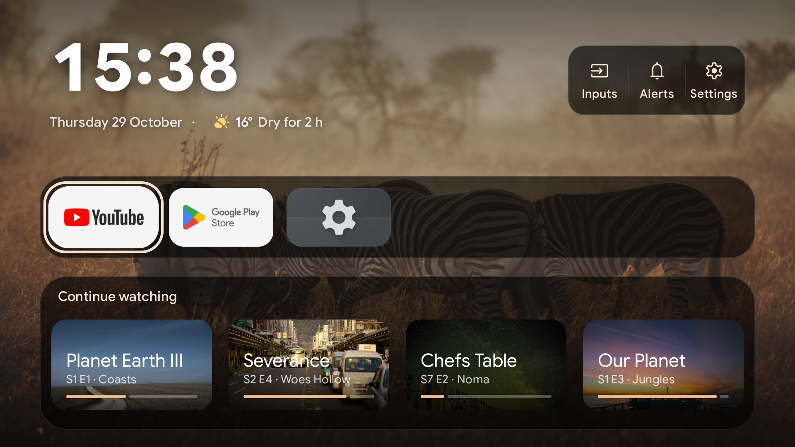
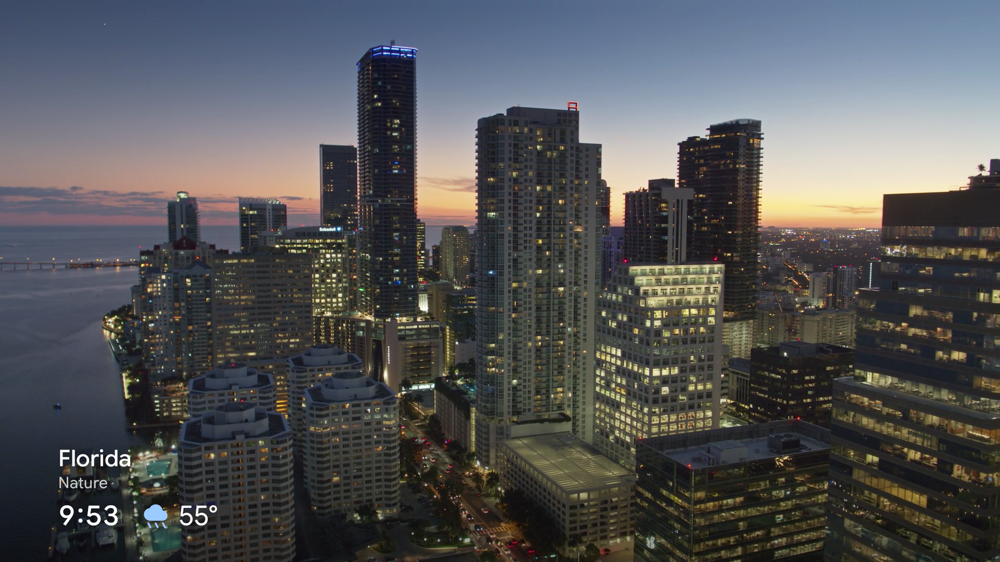
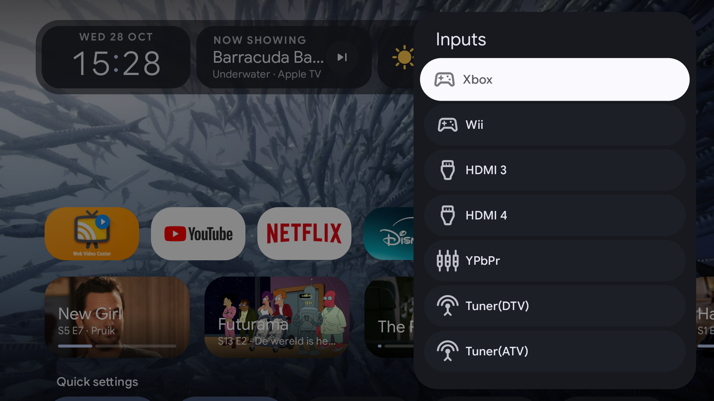
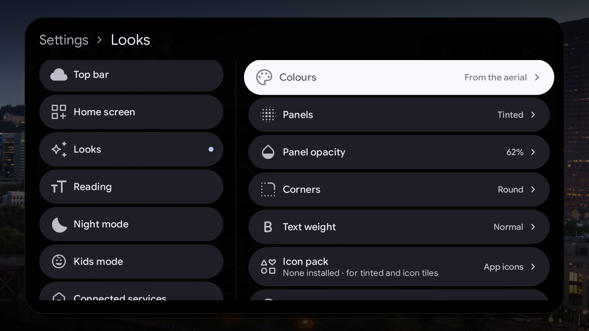
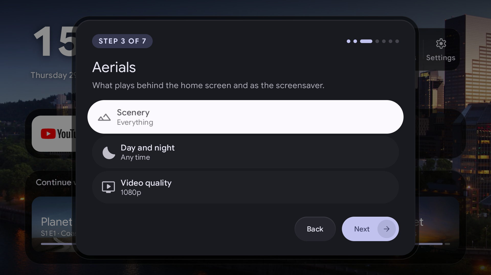

<p align="center"></p>

# Aerial: an Android TV launcher with Apple TV aerials

[](https://github.com/Gulianrdgd/aerial-tv-launcher/releases/latest)
[](https://github.com/Gulianrdgd/aerial-tv-launcher/releases)
[](LICENSE)


Aerial is a custom launcher (home screen replacement) for Android TV and Google TV. Slow aerial video plays behind everything, the way it does on an Apple TV, and the panels on top follow Material You: their colours are picked from whatever clip is on screen. It has no ads and no sponsored rows.

Aerial is free forever. I use it on my own TV, and I'm not going to pay myself for it.

[Download the latest APK](https://github.com/Gulianrdgd/aerial-tv-launcher/releases/latest/download/aerial.apk) and see [Install](#install) for how to get it onto your TV.



## Features

- **Home screen:** a bold clock on the aerial with the date and a two-hour rain forecast, a six-app dock with each app's own banner, a Continue Watching row from your streaming apps, quick settings, and the rest of your apps. Hold OK on an app to move, pin, hide or uninstall it.
- **Screensaver:** after two minutes without input the panels fade and the aerial plays full screen, much like Chromecast's ambient mode, with its name, the time, the weather and whatever is playing. It can also be the TV's own Android screensaver, so it shows over any app.
- **Aerials your way:** pick cities, nature, underwater or space, play day clips by day and night clips after sunset, like or skip clips by holding OK, and play 4K HDR on TVs that support it.
- **Your own backgrounds:** photos and videos from a USB stick or SD card, or the address of a video, a live stream or a web folder.
- **Now Playing and notifications:** a card with album art and play controls, and a notifications panel.
- **Media rows:** Jellyfin (Continue watching, Next up) and Plex (On Deck) rows, after you sign in.
- **Inputs:** switch HDMI ports by the names you gave them, and pin an input such as "HDMI 2 · PlayStation" to the dock.
- **Everyday extras:** weather forecast by the hour or day, night mode that dims the panels, a sleep timer, picture off with sound still playing, status icons for network and storage, and an optional app or input that opens when the TV turns on.
- **Kids mode:** apps open only during the hours you allow.
- **Burn-in protection:** the screensaver's clock and title drift slightly every few minutes.

Everything added since 0.2 is off until you turn it on. [ROADMAP.md](ROADMAP.md) lists what's there and what's planned.





## Aerials

There are 265 clips, at 1080p or 4K on the Apple ones, from Apple's TV screensaver, from Fire TV and from community collections. Each one is tagged as city, nature, underwater or space, so you can pick the scenery in Settings or in the quick settings row.

Clips stream when they're shown and nothing is downloaded ahead. The last one or two clips stay in a 300 MB cache, so the screen comes up straight away after a restart and still has something to play when you're offline.

## Settings



Settings open from the gear in the top bar. The categories are on the left and their settings on the right, with the path at the top, so you always know where you are. A choice lists all its options at once, and on/off settings have a switch.



On first start a short setup asks about the Home button, the aerials, the clock and weather, and access. You can run it again from Settings › System.

Weather comes from Open-Meteo, which needs no account. Aerial guesses your city from the TV's timezone, and you can type a different one.

## Install

Aerial installs as a normal APK, but two things need a one-time adb command from a computer: notification access, for Now Playing and the notifications panel, and on some TVs switching off the stock launcher so the Home button opens Aerial. That makes adb the best way to install it. If you have no computer, see [Without a computer](#without-a-computer).

### With adb (recommended)

1. On the TV, open Settings, then System (or Device Preferences), then About, and select the build number seven times. Developer options now appear in Settings. Turn on USB debugging there. On Android 11 and newer some TVs call it Wireless debugging and want you to pair first with `adb pair <ip>:<port>`.
2. With your computer on the same network as the TV, connect and accept the prompt on the TV:

   ```sh
   adb connect <your TV's IP address>
   ```

3. Download and install Aerial:

   ```sh
   curl -L -o aerial.apk https://github.com/Gulianrdgd/aerial-tv-launcher/releases/latest/download/aerial.apk
   adb install -r aerial.apk
   ```

4. Let Aerial show what's playing and your notifications (see [Permissions](#permissions)):

   ```sh
   adb shell cmd notification allow_listener nl.julian.aerial/nl.julian.aerial.media.LauncherListenerService
   ```

To update, run the two commands in step 3 again. Your settings stay.

### Make it your home screen

The first time you open Aerial, a short setup walks you through this. On most TVs it opens the TV's own setting, where you choose Aerial as the Home app.

Some TVs, Philips among them, keep opening the stock launcher when you press Home. Switch it off for your user over adb, after Aerial is installed so the TV always has a home screen:

```sh
adb shell pm disable-user --user 0 com.google.android.tvlauncher
```

`adb shell pm enable com.google.android.tvlauncher` brings it back.

### Without a computer

You can install Aerial on the TV itself. Now Playing and notifications stay off until you run the adb command from step 4 some day, and on some TVs the Home button keeps opening the stock launcher.

- **Downloader app:** install Downloader (free, from AFTVnews) from the Play Store on your TV, open it and enter `github.com/Gulianrdgd/aerial-tv-launcher/releases/latest/download/aerial.apk`. When the TV asks, let Downloader install apps from unknown sources, then choose Install.
- **USB stick:** download [aerial.apk](https://github.com/Gulianrdgd/aerial-tv-launcher/releases/latest/download/aerial.apk) on a computer and copy it to the stick. Plug it into the TV and open the file with a file manager app such as X-plore or File Commander. Allow the file manager to install apps when asked.

### Clean up your TV (optional)

Many TVs ship with ad services, telemetry and preinstalled apps you may not want. [CleanYourTV](https://github.com/Gathin23/cleanyourtv) (MIT licence) disables them over adb from a computer with `pm disable-user`, so nothing is uninstalled and its restore script can undo the changes. Its `examples/` folder holds debloat lists that people tested on specific TV models.

Before you use it, or any similar tool:

- It also installs its own home screen and makes it the default, so choose Aerial again afterwards under Default home app.
- Install Aerial before disabling the stock launcher, so the TV always has a home screen.
- Disabling a package the TV depends on can cause problems. Apply lists in small batches and keep the restore script at hand.
- A firmware update can bring removed packages back and reset the Home app.
- CleanYourTV lists Samsung, LG, Roku, Vizio and Hisense VIDAA TVs as unsupported, because they don't offer adb access.

## Permissions

Continue Watching asks for access the first time you select it, through the usual Android dialog.

Now Playing and notifications need notification access. Android TV has no screen to grant that, so do it once over adb:

```sh
adb shell cmd notification allow_listener nl.julian.aerial/nl.julian.aerial.media.LauncherListenerService
```

## Development

The app is written in Kotlin with Jetpack Compose and `androidx.tv:tv-material`. Video plays through Media3 ExoPlayer, settings are stored with DataStore, and the colour schemes come from Material Color Utilities.

Build a release APK and install it over adb:

```sh
./gradlew :app:assembleRelease -PlocalSign
adb install -r app/build/outputs/apk/release/app-release.apk
```

`-PlocalSign` signs the build with your local debug key. Without it the release build is unsigned.

Run the unit tests with `./gradlew :app:testDebugUnitTest`.

GitHub Actions builds and tests every push. When a `v*` tag is pushed it also signs a release APK and attaches it to the release, but only if the repository has these secrets: `KEYSTORE_BASE64` (the keystore, base64-encoded), `KEYSTORE_PASSWORD`, `KEY_ALIAS` and `KEY_PASSWORD`. Use the same key as earlier releases, or the new APK won't install over the old one.

Debug builds have test hooks for the emulator. They all go through one receiver:

```sh
adb shell am broadcast -n nl.julian.aerial/.debug.FakeMediaReceiver -a <action>
```

`play`, `pause` and `stop` control a fake track for Now Playing. `input-on` and `input-off` add or remove a fake TV input. Post a test notification with `adb shell cmd notification post -t 'Title' tag 'Text'`.

## Translations

Aerial is in English, Dutch, French, German, Italian, Portuguese and Spanish. Each language is one JSON file of English texts and their translations, so adding yours needs no code: see [CONTRIBUTING.md](CONTRIBUTING.md).

## Licence

GPL-3.0. The aerial list and the approach to video playback come from [couchy-launcher](https://github.com/conreo/couchy-launcher). See [NOTICE](NOTICE) for that and for the bundled font and icons.
